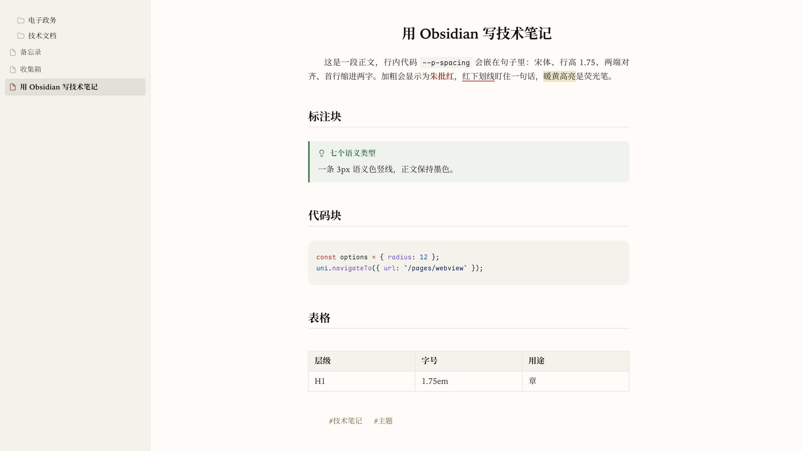

# Folio · Obsidian 主题

一款偏「现代文档」的 Obsidian 主题：默认是 ChatGPT 网页端那套**中性灰 + 蓝色强调色**，
也可以一键切回**纸感书卷**（宋体正文 + 首行缩进 + 标题居中）。

独立仓库，独立版本管理。



## 仓库结构

```
obsidian-theme-folio/
├── manifest.json     ← 主题元信息（Obsidian 读取）
├── theme.css         ← 主题全部样式 + Style Settings 配置
├── versions.json     ← 主题版本 → 最低 Obsidian 版本
├── INSTALL.md        ← 面向使用者的安装说明（分享时带上）
├── screenshot.png    ← 预览图（上架社区主题也需要）
├── package.sh        ← 打分享用的 zip 到 ~/Downloads
├── install.sh        ← 开发用：软链到某个 vault
├── preview.html      ← 开发用：浏览器里的预览页
├── LICENSE
└── README.md
```

主题以软链方式接入 vault：`<vault>/.obsidian/themes/Folio -> 本仓库`。
Obsidian 只认 `.obsidian/themes/<名字>/theme.css`，而 `.obsidian/` 通常被 vault 的
`.gitignore` 忽略；把主题独立成仓库再软链进去，就能脱离 vault 独立做版本管理、备份与发布。

## 安装

**开发时（本机）**：用软链，改完 CSS 直接生效。

```bash
./install.sh                       # 默认链接到同级的 obsidian-library vault
./install.sh /path/to/your/vault   # 或指定 vault
```

**分享给别人**：见 [`INSTALL.md`](INSTALL.md)。简要版是把本仓库改名为 `Folio`
放进对方的 `<库>/.obsidian/themes/`，然后在 `设置 → 外观 → 主题` 里选它。

> 新装了字体后，**需要完全退出并重启 Obsidian** 才会生效（Chromium 只在启动时枚举系统字体）。

## 分享给别人

```bash
./package.sh                # 生成 ~/Downloads/folio-obsidian-theme-v<版本>.zip
./package.sh /path/to/dir   # 或指定输出目录
```

zip 里只含使用者需要的文件（`theme.css` / `manifest.json` / `versions.json` /
`INSTALL.md` / `README.md` / `LICENSE` / `screenshot.png`），不含开发脚本。

想让别人**在 Obsidian 里直接搜到并安装**，需要上架社区主题列表，见文末「发布到社区主题」。

## 字体方案

配套三套字体，缺失的已下载安装到 `~/Library/Fonts/`：

| 用途 | 字体 | 来源 |
| --- | --- | --- |
| 正文 / 标题 | **Iowan Old Style**（西文）+ **思源宋体 Noto Serif CJK SC**（中文） | Iowan 系统自带；思源宋体已安装 |
| 目录 / 文件树 | **Bear Sans UI** + **Noto Sans SC** + 苹方 | 本机已有 |
| 代码 | **Maple Mono**（中文友好） | 本机已有 |

新增字体文件：

```
~/Library/Fonts/NotoSerifCJKsc-Regular.otf   思源宋体 常规
~/Library/Fonts/NotoSerifCJKsc-Bold.otf      思源宋体 粗体
~/Library/Fonts/LXGWWenKai-Regular.ttf       霞鹜文楷（备选「纸感」正文字体）
```

三套字体都可在 `Style Settings → Folio` 里一键切换（各有一组预设）。

## 调参（Style Settings）

已接入 `obsidian-style-settings`。在 `Settings → Style Settings → Folio`：

- **排版**：正文字体、目录字体、代码字体、行高、段距、正文栏宽
- **配色**：ChatGPT 模式（默认开）
- **标题**：H1~H6 字号、标题上方留白
- **表格**：最小列宽
- **版面**：取消居中栏宽、**标题居中**、**标题分隔线**、**两端对齐**、**首行缩进**、聚焦模式
- **专注**：隐藏滚动条、隐藏状态栏
- **编辑器**：**当前行高亮**、**隐藏 Markdown 语法**（见下）
- **文件树**：紧凑行高、显示缩进引导线

> 正文字号不在此处，请用 `Appearance → Font size`（推荐 17）。原因是 Obsidian 把字号写在
> `body` 的行内样式上，主题无法在不破坏原生滑杆的前提下覆盖它。

## 书籍排版（默认开启）

参考当代书籍排版，以下四项**默认开启**，都能在 `Style Settings → Folio → 版面` 一键关掉：

| 项 | 效果 |
| --- | --- |
| 标题居中（书名式） | 笔记标题（文件名）居中，像书页的章名 |
| 标题分隔线 | H1–H3 下方一条细线，**阅读视图与实时预览都生效** |
| 正文两端对齐 | 中文书籍常见的齐行 |
| 段落首行缩进两字 | 中文书籍正文的段落起首缩进（编辑区只对纯段落行生效） |

主题整体为**浅色**：浅白纸面（`#fcfbf8`）+ 墨色宋体。请在
`Appearance → Base color` 选择 **Light**。

## 隐藏 Markdown 语法

参考 Minimal 的 *Hide Markdown syntax*，在实时预览里隐藏 `**`、`*`、`~~`、`==`、`[[ ]]`、`#`
等标记（`cm-formatting-*`），让编辑区看起来更像成稿。

- 开启：`Style Settings → Folio → 隐藏 Markdown 语法`
- 注意：字符仍然存在，只是不显示；**光标所在那一行也照样隐藏**（与 Minimal 一致），
  且默认**不留占位**。唯一例外：当标记正好是该行最后一个元素时（例如刚打完 `##`
  的空标题），会保留标记宽度、只把字形变透明——否则光标没有落点会消失，后续输入
  也会跑到标记前面（标题打不出来）。因为它已在行尾，这点占位看不出来。

## 设计取向（对应需求）

| 需求 | 落地方式 |
| --- | --- |
| 标题字号递减且大于正文 | `--h1-size`…`--h6-size` 用 `em`，均 > 1em；由 1.9em 递减到 1.02em |
| 标题颜色区分正文 | 独立的 `--folio-heading-*` 墨色，比正文更深/更亮 + 更重字重 |
| 标题上下留白 | `--heading-spacing`（默认 1.7em）+ 每级 `margin-block` |
| 复杂文档不费力 | 行高 1.75、段距 1.05em、栏宽 42rem（约 30~45 汉字/行） |
| 纸质书感 | 浅白纸面 + 墨色宋体正文、两端对齐、首行缩进、居中书名、标题分隔线、居中短分隔线 |
| 去除干扰 | 收敛侧栏/标签栏描边、可隐藏状态栏与滚动条、聚焦模式 |
| 文件树 | 文件夹用「开 / 关」SVG 图标（`mask` 实现，颜色跟随主题）；行距 / 圆角 / 缩进由 `--nav-item-*` 变量控制；字号 `--nav-item-size: 14px`（GPT 规范）；缩进 22px 让子项文件名与父文件夹名对齐；去掉缩进引导线；选中文件左侧强调竖条 |
| ChatGPT 模式 | 一键切换「配色 + 字体 + 排版」：中性灰（浅色 `#ffffff` / `#f9f9f9` / `#f3f3f3`，主文字 `#212121`，次级 `#6b6b6b`，边框 `#e5e5e5`；深色 `#212121` / `#171717` / `#303030`）+ 蓝色强调色 `#3983f7` + **正文无衬线、标题沿用纸感衬线** + 左对齐 / 不缩进 / 标题不居中 / 标题无分隔线 |
| 字号层级 | 全局生效（两种模式都一样）：侧边栏 14px / 400、正文 16px / 行高 28px、H1 28px / 700、H2 22px / 700、代码块 13px、行内代码 0.88em、侧边栏分组标题 12px、标签标题 14px |
| 日历 | 给 Calendar 插件的 `.today` 加实心强调色底 + 反白文字，高亮当前日期 |
| 表格 | 默认全宽、列宽平分（`table-layout: fixed`，不随内容变化）、长内容换行；平分后小于「最小列宽」时表格变宽并可横向滚动 |
| 代码块 | 参考 ChatGPT 网页端：12px 圆角容器（浅色 `#f6f8fa` / 深色 `#2b2b2b` + 细边框）+ 内容内边距 16/18px + 13px / 行高 1.7 等宽。语法色统一走 `--code-*` 变量（阅读模式 Prism `.token.*` 与编辑器 `cm-*` 共用同一套）。编辑器里代码块是一串 `.cm-line`，中间行直角、只给首/末行圆角（不给围栏相邻行加圆角，否则留缺口） |
| 行内代码 | 半透明灰底 `rgba(127,127,127,0.13)` + 细边框 + 5px 圆角 |
| 当前行 / 加粗 | 光标所在行铺一层浅底，用一叠 `box-shadow`（每段平移量为行宽的 0.7 倍，保证互相咬合）横向铺满编辑区；底色不透明，避免半透明叠加出现色阶。加粗文字为红色（`--bold-color`） |
| 引用块 | 浅色圆角背景（`--folio-quote-bg`）+ 一条灰色左边线。编辑器里多行引用由逐行底拼成整段，只在首/末行圆角；左边线改 `--blockquote-border-color` 且不再自加边框，避免与 Obsidian 默认的主体色竖线叠成两条 |

## 注意

- 旧 snippet `hide-tree-lines.css` / `edit-css.css` 与主题的文件树样式重叠，建议在
  `Settings → Appearance → CSS snippets` 里**关闭这两个**，避免 `!important` 打架。
- 主题显式接管正文与代码字体（`--font-text` / `--font-monospace`），所以 `Appearance` 里的
  「Text font / Monospace font」下拉会被主题覆盖；改字体请用 Style Settings。
- 深色模式保留了一套配套的「炭墨」配色，但本主题以浅色为主；不切到深色就不会生效。

## 开发

改 `theme.css` 后，Obsidian 会自动重载（软链指向本仓库，无需复制）。
`preview.html` 可直接用浏览器打开看排版，或用无头 Chrome 截图：

```bash
"/Applications/Google Chrome.app/Contents/MacOS/Google Chrome" \
  --headless=new --disable-gpu --screenshot=out.png \
  --window-size=900,1200 "file://$PWD/preview.html"
```

## 发布到社区主题

仓库根目录已具备上架所需文件：`manifest.json`、`theme.css`、`versions.json`、`README.md`、`LICENSE`。
还差：

1. 一张 `screenshot.png`（Obsidian 社区页展示图）
2. 推到 GitHub，向 [obsidianmd/obsidian-releases](https://github.com/obsidianmd/obsidian-releases) 提 PR

版本号同时更新 `manifest.json` 与 `versions.json`。
