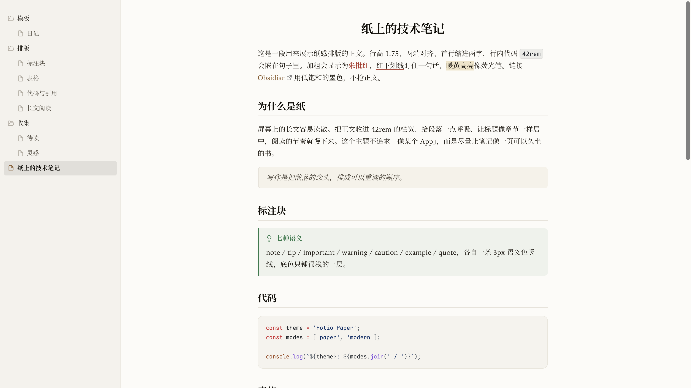
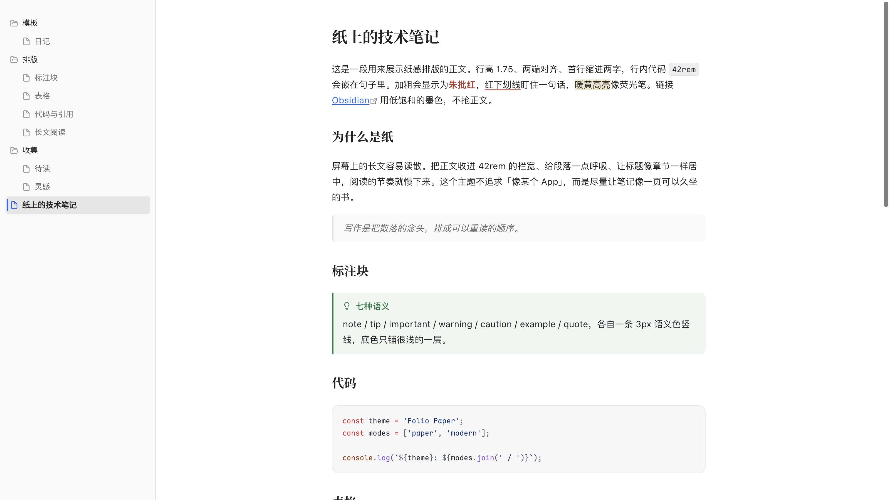
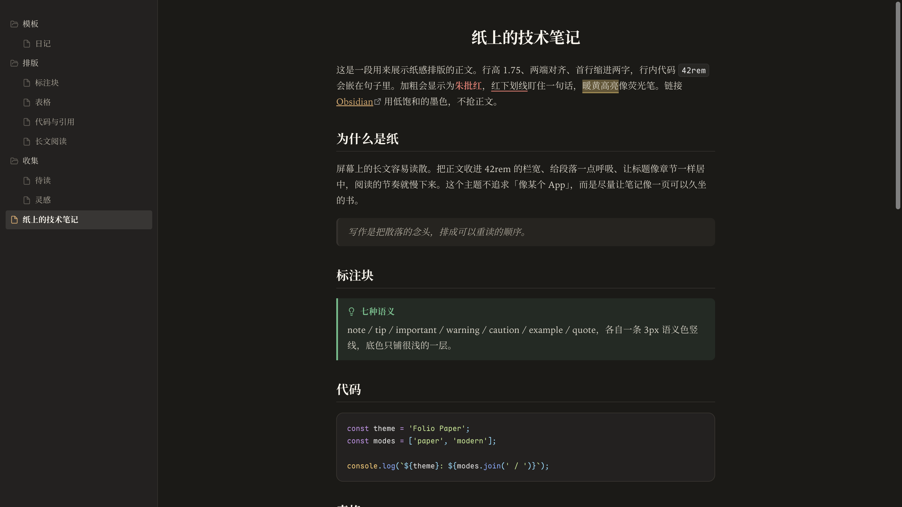
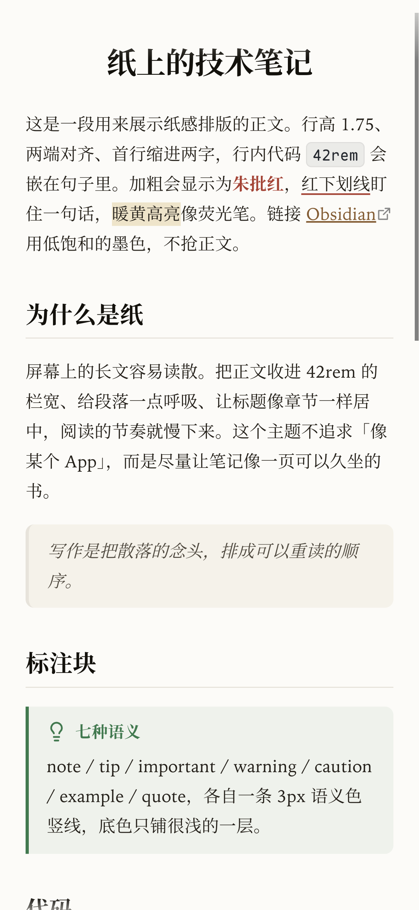
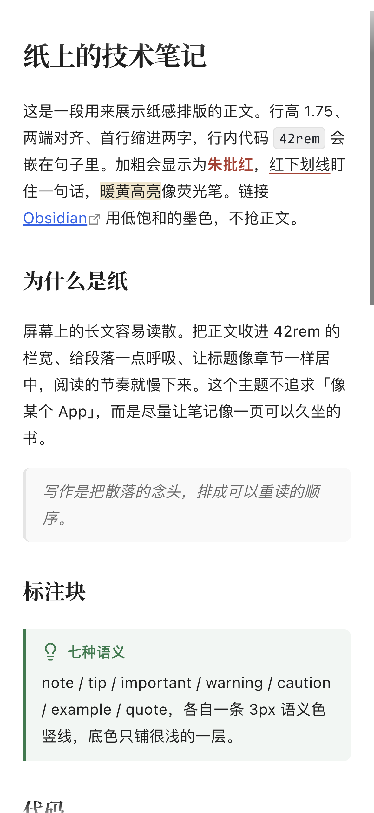
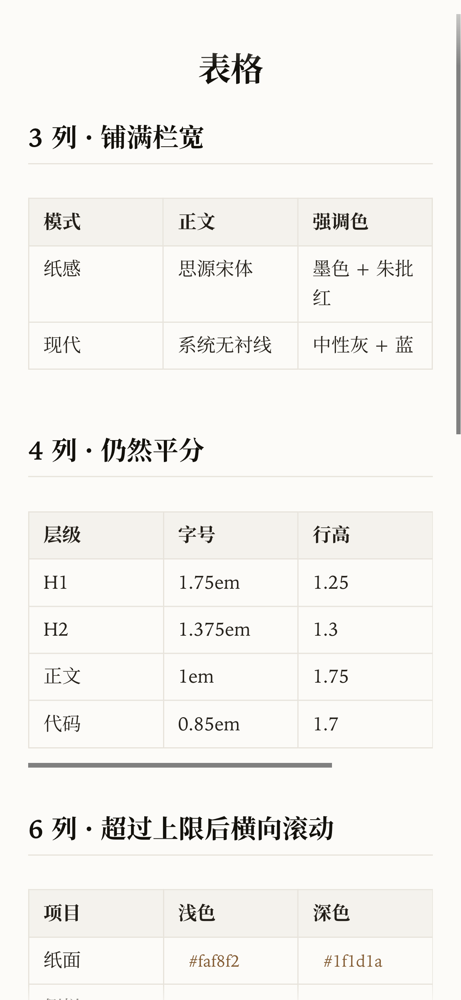
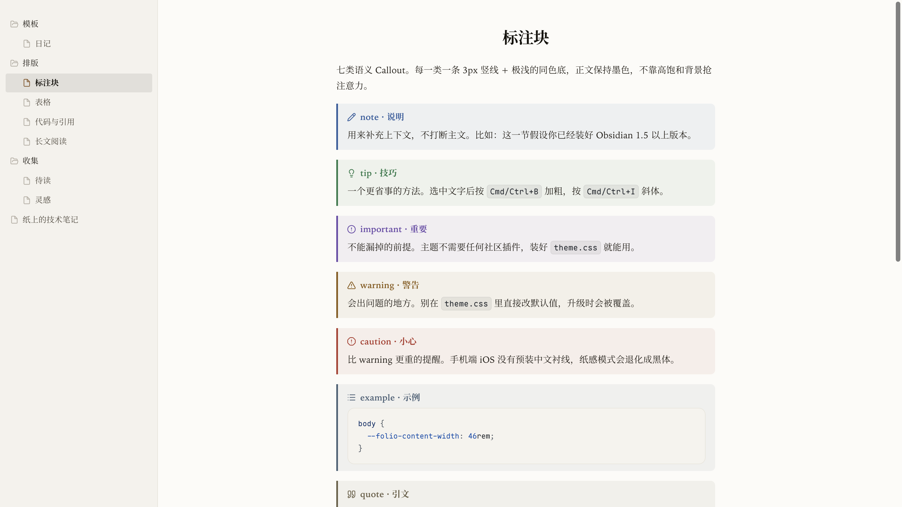
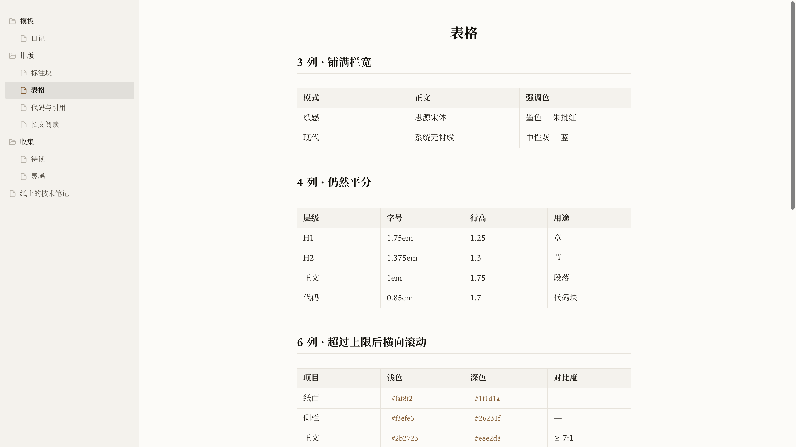

# Folio Paper · Obsidian 主题

一款「纸感书卷」的 Obsidian 主题：宋体正文、两端对齐、首行缩进两字、居中书名、标题分隔线、朱批红。
想换现代文档风，一键切成中性灰 + 蓝色强调色的 **现代模式（Modern）**。

*An editorial, paper-like Obsidian theme with CJK-friendly serif typography. No plugins required.*

**零插件依赖**：不装任何社区插件，开箱就是完整的默认外观。Style Settings 只是可选的调参面板，不是依赖。



## 两种观感

| 纸感（默认） | 现代模式 |
| --- | --- |
|  |  |
| 暖白纸面、墨色宋体、书籍排版 | 中性灰、蓝色强调、无衬线、左对齐 |

深色模式两套配色都适配：



手机端（iPhone / Android）：

<p align="left">
  
  
  
</p>

### 更多截图

| 标注块 | 表格 |
| --- | --- |
|  |  |

## 特性

| 领域 | 做了什么 |
| --- | --- |
| 书卷排版 | 宋体正文 + 两端对齐 + 首行缩进两字 + 居中书名 + H1–H3 标题分隔线（都可关） |
| 两套配色 | 纸感为默认（暖白纸面 + 墨色）；现代模式（中性灰 + 蓝），各含浅色与深色 |
| 标题层级 | H1 1.75em 递减到 H6 1.02em，始终大于正文；独立墨色 + 字重，上下留白充足 |
| 标注块 | 七类语义 Callout（note / tip / important / warning / caution / example / quote）：3px 语义色竖线 + 极浅同色底 |
| 表格 | 占满栏宽、列宽平分、长内容换行；超过设定列数才横向滚动；手机默认 3 列 |
| 编辑器 | 朱批红下划线（`<u>文字</u>`）、暖黄高亮、当前行浅底、可隐藏 Markdown 语法 |
| 聚焦模式 | 调暗非当前内容，悬停行与光标行亮起（纯 CSS） |
| 文件树 | 文件夹与文件各有 SVG 图标、22px 缩进、纸感模式按「书的目录」重做 |
| 移动端 | 手机顶栏不透明、正文与阅读视图对齐、表格列宽与滚动优化、日期输入框修复 |
| 可调 | 接入 Style Settings（可选）：字体、行高、段距、栏宽、标题字号、表格列数、各项开关 |

## 安装

### 从社区主题市场（上架后）

`设置 → 外观 → 主题 → 管理`，搜索 **Folio Paper**，安装并启用。

### 手动安装

1. 下载本仓库或 Release 里的 zip
2. 解压后把 `Folio Paper` 文件夹放进：

```
<你的库>/.obsidian/themes/Folio Paper/
├── manifest.json
└── theme.css
```

3. `设置 → 外观 → 主题`，选择 **Folio Paper**

> 关键：`manifest.json` 与 `theme.css` 必须在**同一层**，不要多套一层文件夹。

### 从源码安装（开发用）

```bash
git clone https://github.com/jiuxianzai/obsidian-theme-folio.git
cd obsidian-theme-folio
./install.sh /path/to/your/vault
```

`install.sh` 会把仓库软链到 `<vault>/.obsidian/themes/Folio Paper`。
已经存在同名真实目录时不会覆盖，脚本会提示你先备份。

## 推荐设置

- `设置 → 外观 → Base color`：**Light**（主题以浅色设计为主，深色也已适配）
- `设置 → 外观 → Font size`：**16**（字号层级按 16px 正文设计）
- 如果以前装过别的主题的 CSS 片段，建议先全部关掉，避免样式打架

## 字体（可选）

主题默认使用系统字体，**不装任何字体也能正常显示**。想更接近设计效果，可以自行安装（均为免费字体）：

| 用途 | 字体 | 说明 |
| --- | --- | --- |
| 中文正文（纸感） | **思源宋体** / Noto Serif CJK SC | 不装会回退到系统宋体 Songti SC；Windows 回退到系统衬线 |
| 备选正文 | **霞鹜文楷** LXGW WenKai | 纸感模式下可在 Style Settings 切换 |
| 代码 | **Maple Mono** | 不装会回退到系统等宽字体 |

> **手机上（iOS）**：系统没有预装中文衬线，`Songti SC` 在 iOS 的 WebView 里也命中不了，
> 正文中文会回落到系统无衬线（苹方），只有西文还是衬线。想要「宋体纸感」，
> 得先在手机上装一款中文衬线（思源宋体 / Noto Serif SC / 宋体 SC）；
> 不想装字体的话，把「正文字体」切成「系统无衬线」，至少两端一致。

## 调参（可选，不需要插件）

主题的默认值写在 `theme.css` 顶部，全部是标准 CSS 变量。最简单的改法是在
`.obsidian/snippets/folio-paper-overrides.css` 里覆盖（记得在 `设置 → 外观 → CSS 片段` 启用）：

```css
body {
  --folio-content-width: 46rem;  /* 正文栏宽 */
  --folio-line-height: 1.8;      /* 正文行高 */
  --folio-table-cols: 5;         /* 每行最多几列 */
}
```

装社区插件 **Style Settings** 后，会出现 `设置 → Style Settings → Folio Paper` 面板，可以图形化调：

- **排版**：正文字体 / 目录字体 / 代码字体、行高、段距、正文栏宽
- **配色**：现代模式（默认关 = 纸感书卷）
- **标题**：H1–H6 字号、标题上方留白
- **表格**：每行最多列数、手机每行最多列数
- **版面**：标题居中、标题分隔线、两端对齐、首行缩进、聚焦模式、取消居中栏宽
- **专注**：隐藏滚动条、隐藏底部状态栏
- **编辑器**：当前行高亮、隐藏 Markdown 语法
- **批注**：红色下划线（朱笔）
- **文件树**：紧凑行高、显示缩进引导线

> Style Settings 只是「遥控器」：不装它，主题的默认外观完全不受影响；装它，才有面板可调。

## 日常使用

- **切换现代模式**：装 Style Settings → `配色 → 现代模式`；或手动在 `theme.css` 的 `@settings` 之外给 `body` 加 `folio-modern-mode` 类（不推荐直接改主题文件）
- **红色下划线**：在笔记里写 `<u>要强调的话</u>`。Obsidian 核心没有「下划线」命令，主题也不绑定快捷键
- **高亮**：`==文字==`，暖黄荧光笔
- **聚焦模式**：Style Settings 打开，或给 body 加 `folio-focus-dim`
- **隐藏 Markdown 语法**：Style Settings 打开（参考 Minimal 的实现思路）
- **宽表格**：实时预览里超过「每行最多列数」后横向滚动；阅读视图会按栏宽换行；手机上默认 3 列
- **手机**：主题对 `is-mobile` 做了专门适配；iOS 想要宋体请先装中文字体（见上）

## 给 AI Agent 使用

仓库根目录有 [`AGENTS.md`](AGENTS.md)，里面是给编码 Agent 的机器可读说明；也有更短的 [`llms.txt`](llms.txt)。把下面这段直接发给 Agent 即可：

```text
请把这个 Obsidian 主题安装到我的库：https://github.com/jiuxianzai/obsidian-theme-folio
要求：
1. 只安装主题，不安装任何社区插件；
2. 主题目录为 <vault>/.obsidian/themes/Folio Paper/，必须包含 manifest.json 和 theme.css；
3. 在 <vault>/.obsidian/appearance.json 里把 cssTheme 设为 "Folio Paper"；
4. 不要修改 theme.css；如需微调，写到 <vault>/.obsidian/snippets/ 下的独立片段；
5. 完成后告诉我怎么在 Obsidian 里确认已启用。
```

Agent 需要知道的约定（详见 `AGENTS.md`）：

- 主题名：`Folio Paper`；安装目录：`.obsidian/themes/Folio Paper/`
- 必需文件：`manifest.json`、`theme.css`；`versions.json` 只用于市场版本记录
- 默认是纸感模式；`body.folio-modern-mode` 切换到现代模式
- 默认开启的排版可用 `folio-no-*` 类关闭（如 `folio-no-justify`）
- 不要引入 `@import`、外部字体或插件依赖

## 参考与致谢

完整的参考对象、使用范围与许可见 [CREDITS.md](CREDITS.md)。简要说明：

| 参考对象 | 用在哪里 | 关系 |
| --- | --- | --- |
| [Folio](https://github.com/elijahchan2019/obsidian-folio-theme)（elijahchan2019 / elijah7x，MIT） | 主题名中的「Folio」、早期命名与社区主题 ID | **独立实现，未复用其代码**；早期曾与其同名同 ID，公开版已更名 Folio Paper 以免混淆，不代表官方版本 |
| [Minimal](https://github.com/kepano/obsidian-minimal)（kepano，MIT） | 「隐藏 Markdown 语法」的交互思路 | 参考实现思路，CSS 为本项目自行编写 |
| [GitHub Alerts](https://docs.github.com/en/get-started/writing-on-github/getting-started-with-writing-and-formatting-on-github/basic-writing-and-formatting-syntax#alerts) | 七类标注块的语义分级与配色骨架 | 参考语义体系，配色与样式按纸感语言重做 |
| ChatGPT 网页端（OpenAI） | 现代模式的配色与排版观感 | 视觉参考，无隶属或背书关系；未使用其商标素材 |
| 中文书籍排版传统 | 两端对齐、首行缩进、居中书名、朱批 | 公共排版惯例 |
| VS Code / Bear | 文件树结构、字体选择 | 观感参考 |

字体（均未打包进主题，仅作为字体栈候选）：

- **Iowan Old Style**：macOS 系统字体
- **思源宋体 / Noto Serif CJK SC**：SIL Open Font License 1.1
- **霞鹜文楷 LXGW WenKai**：SIL Open Font License 1.1
- **Maple Mono**：SIL Open Font License 1.1
- **Bear Sans UI**：仅作为候选字体名，不随主题分发

Style Settings 是 [mgmeyers/obsidian-style-settings](https://github.com/mgmeyers/obsidian-style-settings)（MIT）提供的可选调参插件，不是本主题的依赖。

## 开发与截图

- 主题源码：`theme.css`（纯 CSS，无构建步骤）
- 演示库 / 截图仓库：[obsidian-folio-paper-sandbox](https://github.com/jiuxianzai/obsidian-folio-paper-sandbox)
- 截图在真实 Obsidian 中生成，桌面端 1600×900 @2x，手机端 393×852 @3x
- 提交社区市场前请同步更新 `manifest.json` 的 `version` 与 `versions.json`

## 授权

[MIT](LICENSE) © 2026 youyanping

主题中的配色、排版与 CSS 除「参考与致谢」注明者外，均为本项目编写；参考作品的权利归各自作者所有。
