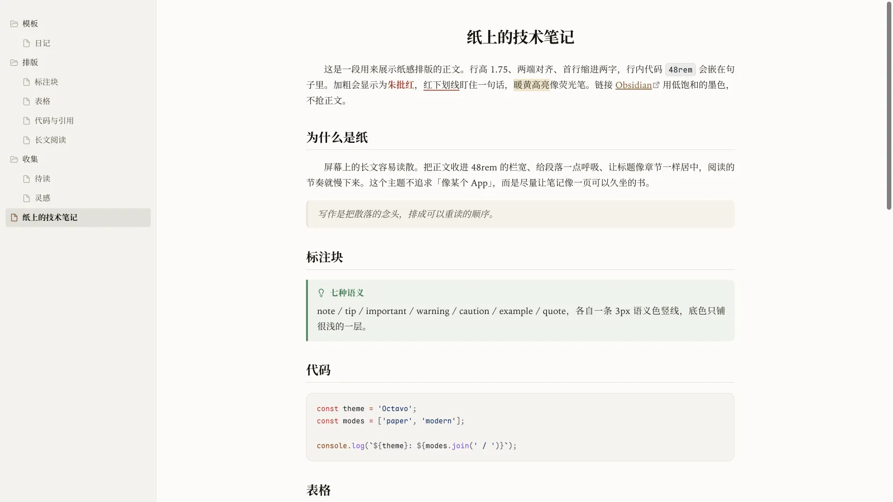
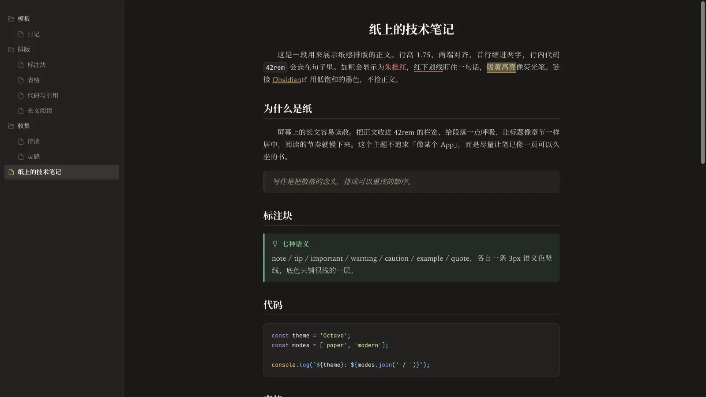
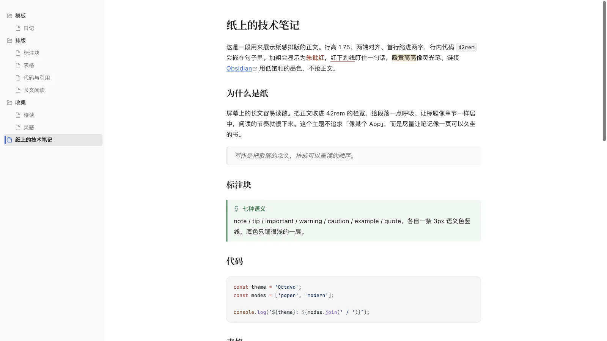
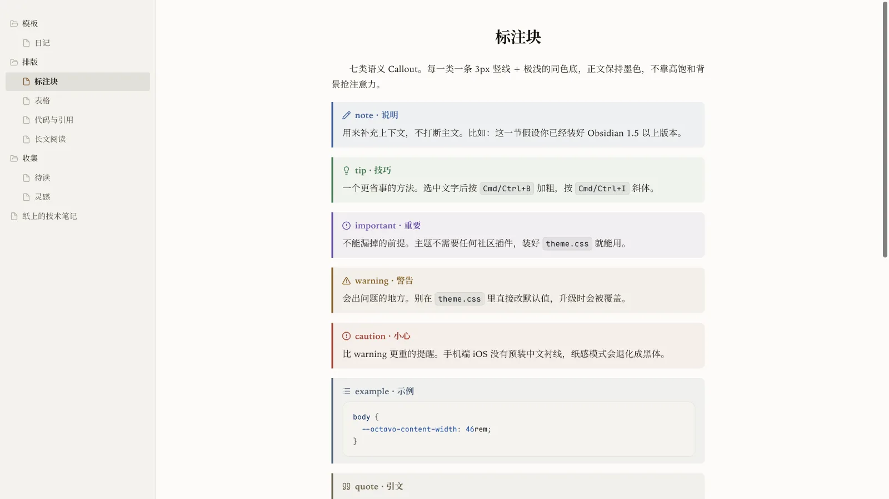
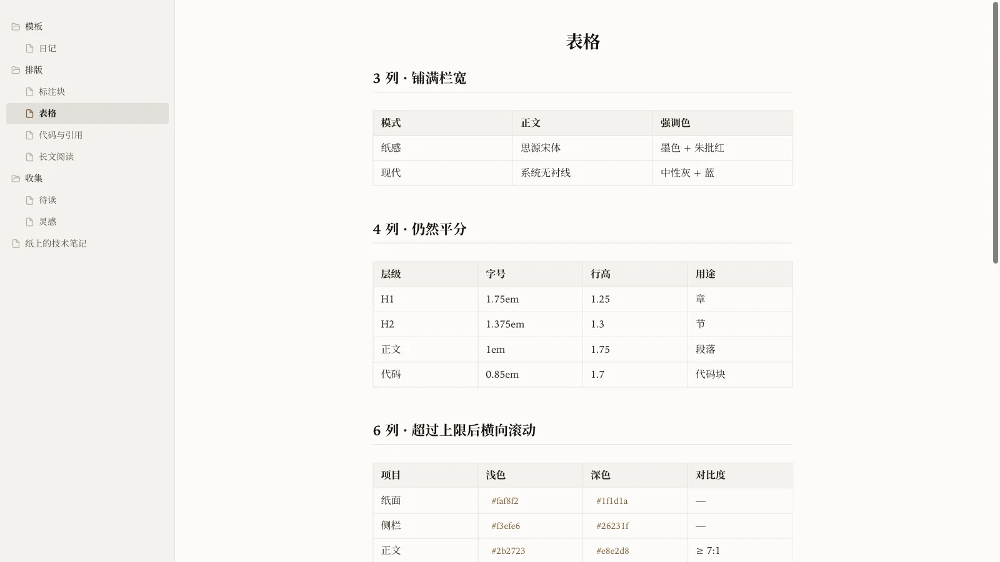
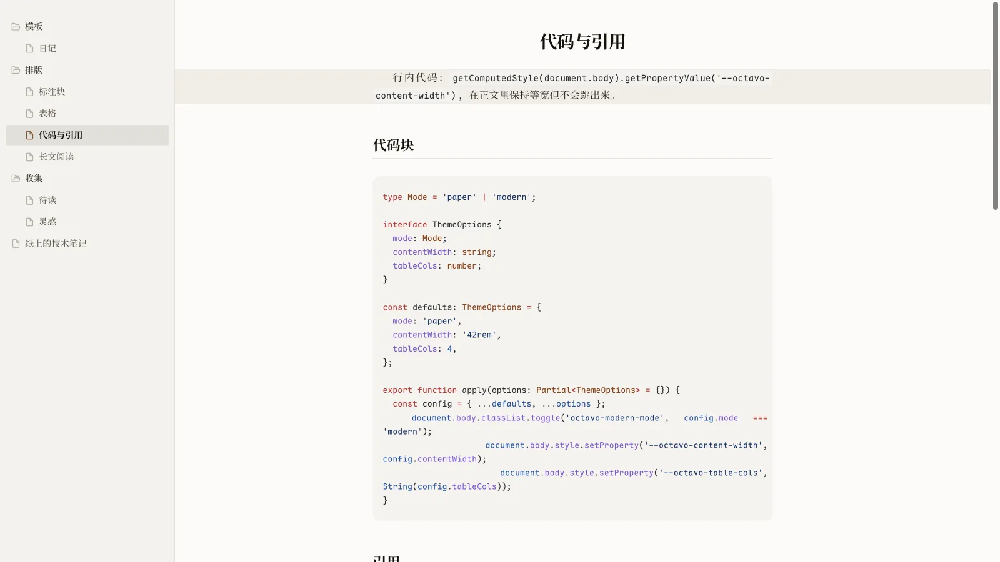
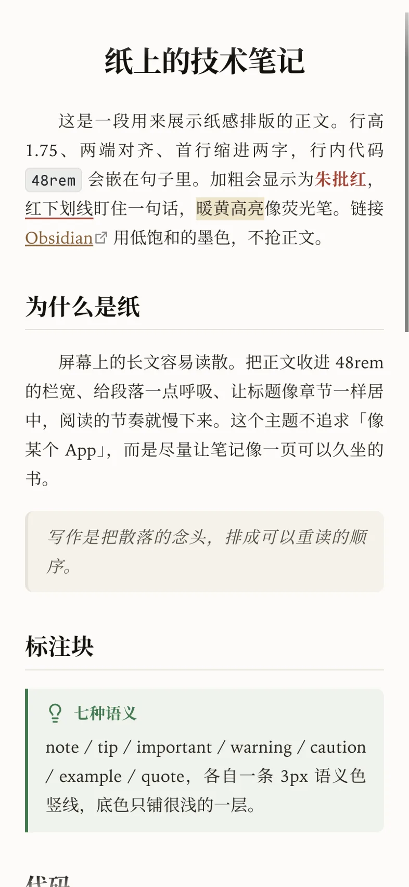
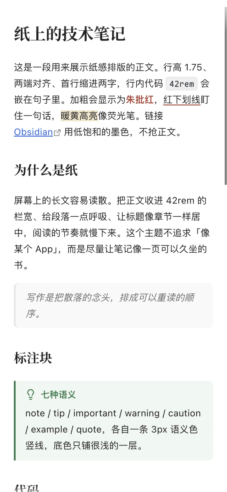

# Octavo

**一款把笔记排成书的 Obsidian 主题。**
宋体正文、两端对齐、首行缩进两字、居中书名、朱批红；另有一套克制的现代模式。
纯 CSS，零插件、零脚本、零构建，安装即用。

*An editorial, paper-like Obsidian theme with CJK-friendly serif typography. No plugins, no snippets, no build step.*



## 为什么叫 Octavo

Octavo（八开本）是西方传统书籍的常见开本。它不追求「像某个 App」，而是让一页笔记更接近一页可以久坐的书：正文收进舒适栏宽，段落有呼吸，标题像章节一样居中，强调色只留一点朱批。

## 特性

| 领域 | 做了什么 |
| --- | --- |
| 书卷排版 | 宋体正文、两端对齐、首行缩进两字、居中书名、H1–H3 标题分隔线 |
| 两套观感 | 纸感（默认，暖白纸面 + 墨色）与现代模式（中性灰 + 蓝色强调色） |
| 浅色 / 深色 | 两套配色都单独校过对比度，深色不是简单反色 |
| 标题层级 | H1 1.75em 递减到 H6 1.02em，始终大于正文；独立墨色与字重，上下留白充足 |
| 标注块 | note / tip / important / warning / caution / example / quote 七类语义色 |
| 表格 | 占满栏宽、列宽平分、长内容换行；超过设定列数才横向滚动，手机默认 3 列 |
| 编辑器 | 朱批红下划线（`<u>文字</u>`）、暖黄高亮、可选当前行高亮（默认关）、可隐藏 Markdown 语法 |
| 界面 | 安静的文件树、克制的侧栏、可选聚焦模式与隐藏滚动条 |
| 手机 | 顶栏不透明、正文与阅读视图对齐、表格列宽与滚动优化、日期输入框修复 |

默认外观不依赖任何插件；文末的 Style Settings 配置块只是可选的调参面板。

## 截图

### 纸感模式

| 浅色 | 深色 |
| --- | --- |
|  |  |

### 现代模式（可选）



### 标注块 / 表格 / 编辑器

| 标注块 | 表格 |
| --- | --- |
|  |  |



### 手机端

<p align="left">
  
  
  
</p>

## 安装

### 从社区主题市场

主题已按社区目录要求准备好。上架后：

`设置 → 外观 → 主题 → 管理`，搜索 **Octavo**，安装并启用。

### 手动安装

1. 从 [Releases](https://github.com/jiuxianzai/obsidian-theme-octavo/releases) 下载最新的 `octavo-v1.0.1.zip`
2. 解压，把 `Octavo` 文件夹放进你的库：

```
<你的库>/.obsidian/themes/Octavo/
├── manifest.json
└── theme.css
```

3. 打开 `设置 → 外观 → 主题`，选择 **Octavo**

> `manifest.json` 与 `theme.css` 必须在**同一层**，不要多套一层文件夹。

### 更新

在 `设置 → 外观 → 主题 → 管理` 里检查更新；手动安装的用户替换 `theme.css` 即可。

## 推荐设置

- `设置 → 外观 → Base color`：**Light** 或 **Dark** 都可以，两套配色分别设计过
- `设置 → 外观 → Font size`：**16**（字号层级按 16px 正文设计）
- 如果以前装过其他主题的 CSS 片段，建议先关掉，避免样式打架
- 不需要安装任何社区插件，也不需要导入任何片段或脚本

## 字体（可选）

主题默认使用系统字体，**不装任何字体也能正常显示**。想更接近设计效果，可以自行安装（均为免费字体）：

| 用途 | 字体 | 说明 |
| --- | --- | --- |
| 中文正文（纸感） | **思源宋体** / Noto Serif CJK SC | 不装会回退到系统宋体 Songti SC；Windows 回退到系统衬线 |
| 备选正文 | **霞鹜文楷** LXGW WenKai | 可在自定义变量里切换 |
| 代码 | **Maple Mono** | 不装会回退到系统等宽字体 |

> **手机上（iOS）**：系统没有预装中文衬线，`Songti SC` 在 iOS 的 WebView 里也命中不了，
> 正文中文会回落到系统无衬线（苹方），只有西文还是衬线。想要「宋体纸感」，
> 得先在手机上装一款中文衬线（思源宋体 / Noto Serif SC / 宋体 SC）。

## 可选调参（纯 CSS，不需要插件）

主题的默认正文栏宽为 **48rem**（约 35–50 个汉字），行高 1.75。默认值都在 `theme.css` 顶部的 `body` 变量里。想改，新建一个 CSS 片段，覆盖对应变量即可（`设置 → 外观 → CSS 片段`）：

```css
body {
  --octavo-content-width: 52rem;  /* 正文栏宽 */
  --octavo-line-height: 1.8;      /* 正文行高 */
  --octavo-para-spacing: 1.1em;   /* 段落间距 */
  --octavo-table-cols: 5;         /* 每行最多几列 */
}
```

不改也能完整使用；这些变量只是留给愿意折腾的人。

<details>
<summary>可选：用 Style Settings 调参（不安装不影响任何默认样式）</summary>

`theme.css` 顶部有一段 `/* @settings */` 配置。安装社区插件
[Style Settings](https://github.com/mgmeyers/obsidian-style-settings) 后，会出现
`设置 → Style Settings → Octavo` 面板，可以图形化调整：

- **排版**：正文字体 / 目录字体 / 代码字体、行高、段距、正文栏宽
- **配色**：现代模式（默认关 = 纸感书卷）
- **标题**：H1–H6 字号、标题上方留白
- **表格**：每行最多列数、手机每行最多列数
- **版面**：标题居中、标题分隔线、两端对齐、首行缩进、聚焦模式、取消居中栏宽
- **专注**：隐藏滚动条、隐藏底部状态栏
- **编辑器**：当前行高亮（默认关）、隐藏 Markdown 语法
- **批注**：红色下划线（朱笔）
- **文件树**：紧凑行高、显示缩进引导线

Style Settings 只是「遥控器」：不装它，上面的默认外观完全不受影响。

</details>

## 日常使用

- **红色下划线**：在笔记里写 `<u>要强调的话</u>`。Obsidian 核心没有「下划线」命令，主题也不绑定快捷键
- **高亮**：`==文字==`，暖黄荧光笔
- **标注块**：`> [!note]`、`> [!tip]` 等七类，主题已内置样式，不需要插件
- **宽表格**：实时预览里超过「每行最多列数」后横向滚动；阅读视图会按栏宽换行；手机上默认 3 列
- **现代模式**：安装可选的 Style Settings 后在面板里打开；不装则始终是纸感模式

## 兼容性

- Obsidian **1.5.0+**，桌面端与移动端
- 浅色 / 深色模式
- 不加载网络字体、不使用 `@import`、不包含 JavaScript
- 不修改 Obsidian 的任何设置文件

## 参考与致谢

- **Folio**（[elijahchan2019 / elijah7x](https://github.com/elijahchan2019/obsidian-folio-theme)，MIT）：主题早期曾用名 `Folio` / `Folio Paper`，公开版定名 **Octavo**，以免与社区主题 Folio 混淆。本项目是独立实现，未复用其 CSS 代码，也不代表其官方版本。
- **Minimal**（[kepano](https://github.com/kepano/obsidian-minimal)，MIT）：「隐藏 Markdown 语法」的交互思路参考。相关 CSS 为本项目自行编写。
- **GitHub Alerts**：七类标注块的语义分级参考；配色与样式按纸感语言重做。
- **ChatGPT 网页端**（OpenAI）：现代模式的配色与排版观感参考，无隶属或背书关系。
- **中文书籍排版传统**：两端对齐、首行缩进、居中书名、朱批。
- **VS Code / Bear**：文件树结构与字体选择的观感参考。

字体（均未打包进主题，仅作为字体栈候选）：Iowan Old Style（macOS 系统字体）、思源宋体 / Noto Serif CJK SC（SIL OFL 1.1）、霞鹜文楷 LXGW WenKai（SIL OFL 1.1）、Maple Mono（SIL OFL 1.1）。

## 授权

[MIT](LICENSE) © 2026 youyanping
